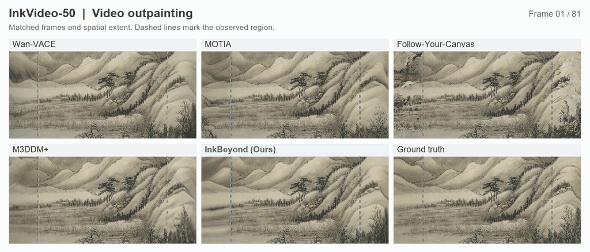
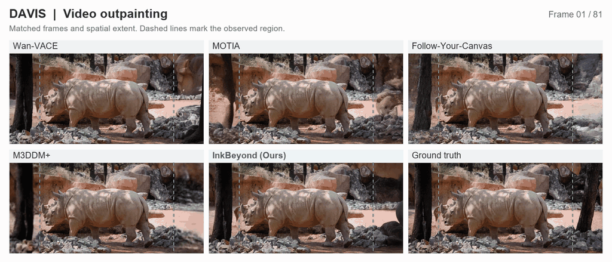

# InkBeyond

### Track-Aware Video Outpainting with Joint Diffusion

This repository presents selected qualitative results of **InkBeyond**, a track-aware framework for temporally coherent video outpainting.

> **Code availability:** Code will be released upon acceptance of the paper.

## Abstract

Video outpainting extends the observed field of view while preserving source content and maintaining spatial and temporal coherence. A single source provides limited evidence for the unseen scene, and independently generated spatial windows can develop inconsistent structure and motion. We propose InkBeyond, a track-aware framework that uses source trajectories to guide joint diffusion across an enlarged canvas. Hierarchical queries retrieve region and contour evidence across frames to form controls for structure, motion, and ink appearance. Three auxiliary canvases calibrate these controls against generation features at different depths and predict bounded velocity corrections in the unknown region. During sampling, all spatial windows read the same full-sequence latent. Their predictions are fused before each global update. The evidence and control modules are adapted through pseudo-outpainting tasks within the observed video. Experiments on InkVideo-50 and the DAVIS dataset show improved reconstruction fidelity, perceptual quality, and temporal consistency over the compared methods. A user study further supports its advantages in spatial coherence, temporal consistency, and content plausibility.

## Qualitative Results

The examples below compare five methods with the ground-truth reference. Each MP4 comparison shows the same 81 frames at 16 fps, with matched spatial extent. The observed input is the central 704 × 480 region of the 1024 × 480 output. Dashed lines mark its boundaries, with generated content on either side.

Lightweight GIFs show every other frame at the original playback speed. Use the MP4 links for higher-quality, full-frame-rate playback. Labels and boundary markers appear only in the comparison views. The separate input, output, and reference clips are unannotated.

### InkVideo-50

[Comparison video](assets/inkvideo50/comparison.mp4) · [Input](assets/inkvideo50/input.mp4) · [Ours](assets/inkvideo50/ours.mp4) · [Ground truth](assets/inkvideo50/reference.mp4)

### DAVIS

[Comparison video](assets/davis/comparison.mp4) · [Input](assets/davis/input.mp4) · [Ours](assets/davis/ours.mp4) · [Ground truth](assets/davis/reference.mp4)

### Display Details

Comparison panels are ordered left to right, top to bottom: **Wan-VACE**, **MOTIA**, **Follow-Your-Canvas**, **M3DDM+**, **InkBeyond (Ours)**, and **Ground truth**. All panels share the same frame index and playback speed. Preview preparation uses uniform resizing, annotations, and web encoding, without frame interpolation or content enhancement. GIF timing is rounded to its supported time resolution.

These are selected qualitative examples. Video properties and file checksums are provided in [results.json](results.json). Third-party source material and baseline outputs retain their original rights.
